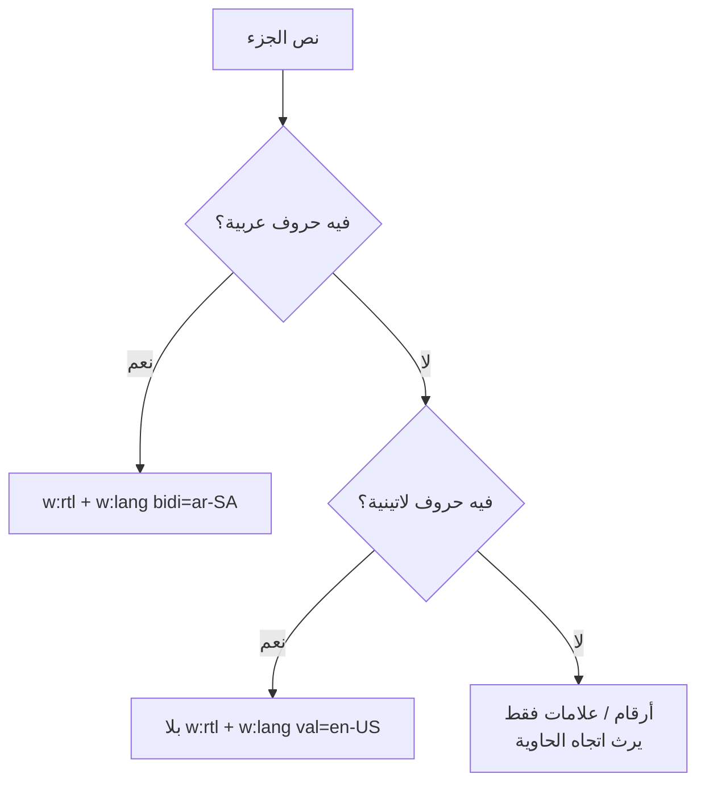

# تصدير النصوص إلى Word بدعم صحيح للعربية والإنجليزية

> ملخص للطريقة المعتمدة في `DocxBuilder` (مجلد `assets/js/export/word/`).
> الفكرة الأساسية: **ثلاث خصائص مستقلة، لكل منها مستوى وقرار مختلف. خلطها هو أصل كل الأخطاء.**

---

## 1. الخصائص الثلاث

| الخاصية      | وسم OOXML | المستوى           | تتحكم في                                         | من يقررها                                                  |
| ------------ | --------- | ----------------- | ------------------------------------------------ | ---------------------------------------------------------- |
| اتجاه الفقرة | `w:bidi`  | الفقرة            | أي حافة تبدأ منها الفقرة، جهة الترقيم والنقاط    | سياسة المستند (`DirectionResolver` عبر `ctx.resolveBlock`) |
| اتجاه الجزء  | `w:rtl`   | الجزء النصي (run) | معاملة الأرقام والعلامات، وخط `cs`، وترتيب العرض | **كتابة النص نفسه**                                        |
| لغة التدقيق  | `w:lang`  | الجزء + الافتراضي | القاموس الإملائي والنحوي                         | كتابة النص نفسه + افتراضي المستند                          |

**القاعدة الذهبية:** اتجاه الفقرة يأتي من سياسة المستند، أما اتجاه الجزء واللغة فيأتيان من **حروف النص** وليس من الحاوية (جدول، قائمة، اقتباس).

---

## 2. مسار قرار الجزء النصي



الجملة المختلطة تُقسَّم إلى أجزاء بالدالة `runs()`:

```
"هذا (GIS) عبر Dry run"
  ├─ "هذا ("      → rtl  · ar-SA
  ├─ "GIS"        → ltr  · en-US
  ├─ ") عبر "     → rtl  · ar-SA
  └─ "Dry run"    → ltr  · en-US   ← العبارة تبقى متصلة
```

العبارة الإنجليزية متعددة الكلمات (`Dry run`, `PostGIS`, `FTTH/FTTX`) تُبقى في جزء واحد. لو فُصلت كلماتها لصارت المسافة بينها جزءًا RTL بين جزأين LTR، ولظهرت `run Dry` مقلوبة داخل السطر العربي.

---

## 3. القواعد التنفيذية

### الفقرات

1. **اتجاه الفقرة** يُرسل عبر `bidirectional` فقط (`w:bidi`)، ويُحسب مرة واحدة للكتلة كاملة.
2. **لا تُرسل `w:jc`** (`alignment`) مع `w:bidi`. Word يفسّر `jc` ضمن سياق `bidi`، فيقع `right` على الحافة اليسرى. الحافة تُختار بـ `w:bidi` وحده. `alignment` يُستخدم فقط لـ `CENTER` أو `JUSTIFIED` لأنهما محايدان.
3. **لا `alignment` في `styles.default.paragraph`**، وإلا ورثته كل الفقرات وعاد خطأ الحافة عبر الأنماط.

### القوائم

4. القرار **مرة واحدة للقائمة كلها** قبل الحلقة، والقوائم المتداخلة **ترث** ولا تعيد القرار. القرار لكل عنصر يجعل النقاط تتبدل الجهات داخل قائمة واحدة.
5. `lvlJc` في `numbering` يبقى `LEFT`، وجهة العلامة تأتي من `w:bidi` على فقرة القائمة.

### الجداول

6. `visuallyRightToLeft` (`w:bidiVisual`) يحدد **ترتيب الأعمدة**، وهو منفصل عن `w:bidi` داخل الخلايا.
7. قرار الجدول واحد للترويسة والجسم معًا.

### الاقتباس والـ callout

8. الحدود والإزاحة **فيزيائية**: `right` للـ RTL و`left` للـ LTR. أسماء `start/end` من المخطط الصارم تتجاهلها إصدارات Word القديمة.
9. الـ callout يمر عبر `inline.runs()` مثل باقي النص. **لا `new TextRun` مباشر**، لأنه يخرج بلا `w:rtl` وبلا لغة.

### الشيفرة

10. كتل الكود **LTR دائمًا**: `alignment: LEFT` و`bidirectional: false`.
11. كل جزء شيفرة وكل `codespan` يحمل `noProof: true` حتى لا تُفحص المعرّفات إملائيًا.

### لغة المستند

12. اللغة الافتراضية في `styles.default.document.run`:

```js
language: { value: "en-US", bidirectional: "ar-SA" }
```

بدونها يعتمد Word على لغة الجهاز، فتُفحص الكلمات الإنجليزية بالقاموس العربي (خطوط حمراء) والعكس.

---

## 4. الكود المرجعي

**الثوابت (`docx-theme.js`):**

```js
lang: { latin: "en-US", bidi: "ar-SA" },
hasRtl: /[\u0591-\u07FF\u0860-\u08FF\uFB1D-\uFDFD\uFE70-\uFEFC]/,
```

**`run()`: الكتابة تقرر الاتجاه واللغة:**

```js
run(opts = {}) {
  const { rightToLeft, language, ...rest } = opts;
  const text = DocxTextUtils.decode(opts.text);
  const hasRtl   = DocxTextUtils.hasRtl(text);
  const hasLatin = /[A-Za-z]/.test(text);

  let rtl = rightToLeft === true;      // الأرقام والعلامات فقط: ترث
  if (hasRtl) rtl = true;
  else if (hasLatin) rtl = false;

  const lang = language ?? (hasRtl
    ? { bidirectional: "ar-SA" }
    : hasLatin ? { value: "en-US" } : undefined);

  return new TextRun({
    font: "Arial",
    ...(rtl ? { rightToLeft: true } : {}),
    ...(lang ? { language: lang } : {}),
    ...rest, text,
  });
}
```

**العبارة اللاتينية (`runs()`):**

```js
static LATIN_PHRASE = /[A-Za-z][A-Za-z0-9]*(?:[ _.\-\/+#:][A-Za-z0-9]+)*/g;
```

**الفقرة:**

```js
paragraphAuto(text, { blockType, explicit, inherited, ...opts }) {
  return new Paragraph({
    ...opts,                                   // بلا alignment
    bidirectional: ctx.resolveBlock(text, blockType, { explicit, inherited }),
  });
}
```

---

## 5. أخطاء واجهناها وأسبابها

| العرض                                 | السبب                                                                               | العلاج                                                   |
| ------------------------------------- | ----------------------------------------------------------------------------------- | -------------------------------------------------------- |
| خطوط حمراء تحت كلمات إنجليزية         | لا `w:lang` في المستند + `w:rtl` موروث على أجزاء لاتينية                            | لغة افتراضية + `run()` يحدد الاتجاه من الحروف            |
| نص الـ callout العربي بلا `w:rtl`     | كان يُبنى بـ `new TextRun` مباشرة                                                   | تمريره عبر `inline.runs()`                               |
| عبارة إنجليزية معكوسة داخل جملة عربية | تقسيم الكلمات الإنجليزية إلى أجزاء منفصلة                                           | `LATIN_PHRASE` تجمعها في جزء واحد                        |
| Word: «واجه خطأ أثناء فتح الملف»      | عناصر `<0/>` في `document.xml`: دفع مصفوفة `runs()` بلا نشر (`...`) داخل `children` | `runs.push(...this.runs(...))` + `flat(Infinity)` كحماية |
| فقرة تلتصق بالحافة الخطأ              | `w:jc` مع `w:bidi`                                                                  | حذف `alignment` والاكتفاء بـ `bidi`                      |
| نقاط قائمة تتبدل الجهات               | قرار الاتجاه لكل عنصر                                                               | قرار واحد للقائمة + وراثة المتداخلة                      |

---

## 6. قائمة التحقق قبل الاعتماد

1. **التحقق من البنية بدون Word:**
   ```bash
   python scripts/office/validate.py out.docx
   unzip -p out.docx word/document.xml | grep -c '<0/>'    # يجب أن يكون 0
   grep -o '<w:lang [^>]*>' <(unzip -p out.docx word/styles.xml)
   ```
2. **في Word:** حدد كلمة إنجليزية داخل جملة عربية وانظر لغتها في شريط الحالة (English US)، ثم كلمة عربية داخل الـ callout (Arabic).
3. **حالات الاختبار:** جملة مختلطة، جدول عربي فيه مصطلحات إنجليزية، قائمة متداخلة، اقتباس، callout، تبويبات، كتلة كود.
4. **أعد التصدير دائمًا** بعد أي تعديل. الملفات القديمة تحتفظ بعلاماتها.

---

## 7. حدود معروفة

| الحد                                                                   | التأثير                                             | الحل المحتمل                                                   |
| ---------------------------------------------------------------------- | --------------------------------------------------- | -------------------------------------------------------------- |
| `tabDirection` قيمة واحدة لكل جسم تبويب (تُحسب من العنوان والجسم معًا) | تبويب فيه عربي وإنجليزي يأخذ اتجاهًا موحدًا للفقرات | اختبار حالة مختلطة، ثم الاختيار بين اتجاه موحد أو كشف لكل فقرة |
| الـ callout يُستخرج نصه من HTML مسطّح                                  | لا Markdown متداخل داخله (قوائم، كود)               | إعادة تحليل الجسم عبر `renderTokens` إن لزم                    |
| أدوات التدقيق العربية غير مثبتة في Word                                | لا فحص للعربي أصلًا                                 | _File ← Options ← Language_                                    |
| مصطلحات إنجليزية تقنية (`Dry-run`)                                     | قد تظهر بخط أحمر لأنها ليست في القاموس              | إضافتها للقاموس أو `noProof` لنمط محدد                         |
